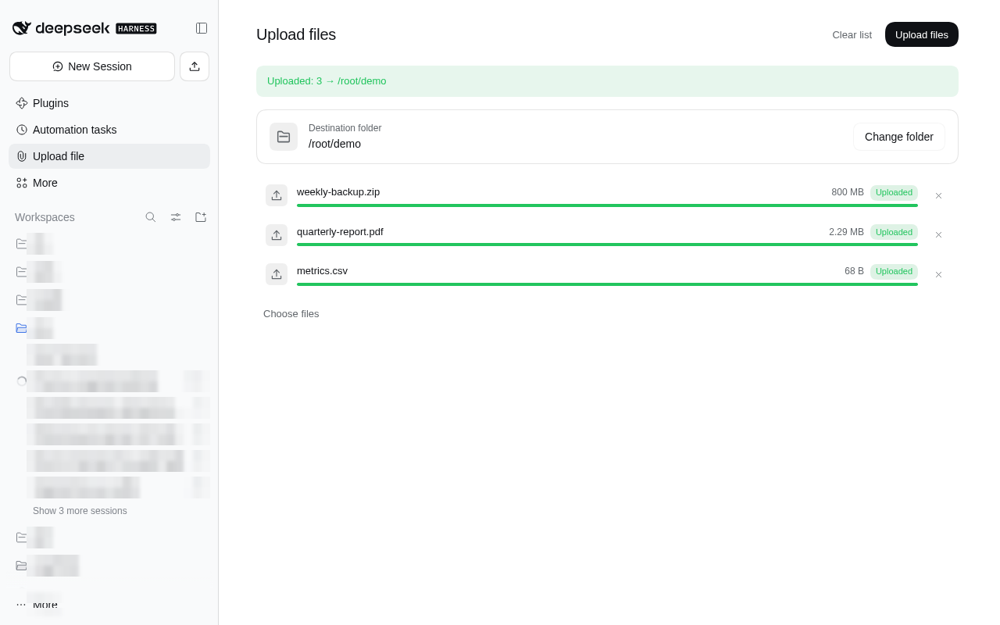
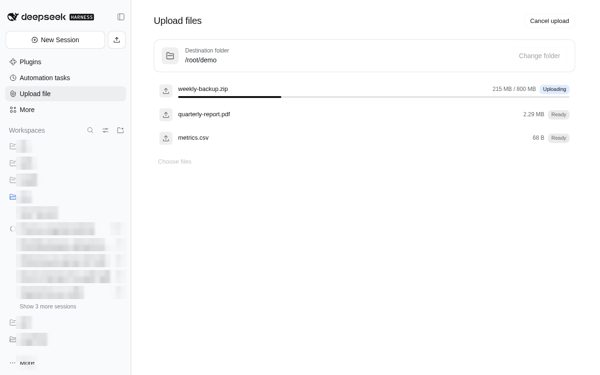

<div align="center">

[English](../../README.md) · [简体中文](README_zh.md) · [繁體中文](README_zh-TW.md) · [日本語](README_ja.md) · [한국어](README_ko.md) · [Türkçe](README_tr.md) · [Русский](README_ru.md) · [Tiếng Việt](README_vi.md) · [ไทย](README_th.md) · **Deutsch** · [Español](README_es.md) · [Français](README_fr.md) · [Українська](README_uk.md) · [Polski](README_pl.md) · [Português (Brasil)](README_pt-BR.md) · [العربية](README_ar.md) · [فارسی](README_fa.md) · [Bahasa Indonesia](README_id.md) · [Italiano](README_it.md)
· [Ελληνικά](README_el.md) · [മലയാളം](README_ml.md) · [Roman Urdu](README_ur-Latn.md) · [Română](README_ro.md) · [Български](README_bg.md)

# @dsh-plugins/file-upload

Eine **Büroklammer-Zeile unter Automatisierungsaufgaben** in der Web-Seitenleiste von [DSH](https://github.com/deepseek-ai/deepseek-harness), die eine Seite zum Hochladen öffnet: einen Ordner auf dem Host so wählen, wie es der Arbeitsbereichsdialog tut, mehrere Dateien auf einmal auswählen und jeden Upload mit seinem eigenen Fortschrittsbalken verfolgen.



<sub>Arbeitsbereichs- und Sitzungsnamen in der Seitenleiste sind unkenntlich gemacht.</sub>

</div>

## Warum

DSH kann Bytes *aus* dem Arbeitsbereich herausbewegen ([`@dsh-plugins/file-download`](https://github.com/tribesman/dsh-file-download)) und stellt Browser-Anhänge für einen Prompt bereit, aber es gab keine Möglichkeit, mehrere vorhandene Dateien ohne eine Shell auf dem Host in einen Ordner auf dem Server zu legen. Dieses Plugin liefert das fehlende Gegenstück – an der Stelle, an der auch die anderen globalen Panels leben.

## Wo es erscheint

| Ort | Was |
| --- | --- |
| Linke Seitenleiste | Eine Zeile **Datei hochladen** mit Büroklammer-Symbol, direkt unter **Automatisierungsaufgaben** (`order: 11`) |
| Hauptspalte | Die Seite zum Hochladen, die durch Auswählen dieser Zeile geöffnet wird |


Alles auf der Seite ist ein einziger Ablauf:

1. **Zielordner** — *Ordner wählen* öffnet einen In-App-Dialog, der von der Verzeichnisauflistung des Hosts selbst angetrieben wird (`ctx.uiWorkspace.listDirectory`, dieselbe Grundfunktion, die hinter **Arbeitsbereichsverzeichnis auswählen** steht): Sprünge in der Brotkrümelnavigation, ein per Klick bearbeitbarer Pfad, ein Umschalter für versteckte Ordner und eine abschließende Bestätigung *Diesen Ordner wählen*. Die Ordnerliste kommt vom Host, deshalb funktioniert es auch aus einem entfernten Browser, in dem es keinen Dateiauswahldialog des Betriebssystems gibt.

   

2. **Dateien wählen** — die Dateiauswahl der Seite nimmt mehrere Dateien auf einmal an, und Dateien, die irgendwo auf die Seite gezogen werden, reihen sich in dieselbe Warteschlange ein.
3. **Dateien hochladen** — die Warteschlange läuft eine Datei nach der anderen ab; jede Zeile zeigt den Zähler der gesendeten Bytes, einen Fortschrittsbalken und ein Status-Etikett. Eine fehlgeschlagene Zeile behält ihre Meldung und bietet **Erneut versuchen**; **Hochladen abbrechen** stoppt die Warteschlange und lässt die übrigen Zeilen bereit zurück.

   

## So funktioniert es

**Host-Hälfte** — eine authentifizierte Streaming-Route auf der gemeinsamen `/api`-Barriere:

```
POST /api/file-upload/write?dir=<absolute folder>&name=<file name>
content-type: application/octet-stream
```

Sie hängt an `ctx.connection.fetch`, sodass Connection die Anfrage anhand des signierten Harness-Anmeldenachweises des Browsers zulässt, bevor dieser Handler läuft: Eine nicht authentifizierte Anfrage erreicht ihn nie, und nur der besitzende Peer wird bedient. Beide Koordinaten werden validiert (ein absolutes, existierendes Verzeichnis; ein reiner Dateiname ohne Trennzeichen), und der Body wird direkt in eine danebenliegende `.dsh-upload-<uuid>.part`-Datei gestreamt, die erst nach dem Eintreffen des letzten Bytes an ihren Platz umbenannt wird — ein abgebrochener oder fehlgeschlagener Upload hinterlässt unter dem echten Namen nichts.

**Browser-Hälfte** — ein handgeschriebenes Lazy-CJS-Bundle, das nur die von der Shell bereitgestellte Basis (`react`, `react-dom`) benötigt. Es registriert zwei Beiträge: die Zeile `sidebar.panellist` und das `main`-Panel mit demselben Schlüssel, was genau der Vertrag ist, den die Seitenleiste zum Auswählen braucht. Der schlichte `XMLHttpRequest` im Thread der Seite macht den Fortschritt pro Datei echt: `xhr.upload.onprogress` meldet die Bytes, die der Browser tatsächlich an den Socket übergeben hat.

## Installation

Das Paket ist ein **Bundle** (`dsh.bundle.patch`), deshalb kann der Plugin-Manager es als eine einzige Zeile installieren und aktualisieren:

```bash
# aus einem Checkout — verlinkt dieses Verzeichnis, Änderungen bleiben live
dsh plugin --profile web add /path/to/dsh-file-upload

# oder aus dem Git-Remote
dsh plugin --profile web add "git+https://github.com/tribesman/dsh-file-upload.git"
```

Beide Wege sind auch über die Oberfläche möglich: **Plugins → Plugin hinzufügen**.

Wenn `dsh` nicht im `PATH` liegt, verlinken Sie den Checkout symbolisch im Profil und fügen Sie die Zeile von Hand hinzu:

```yaml
# $DSH_HOME/profiles/web/cordis.patch.yml
- insert:
    - id: file-upload-panel
      name: '@dsh-plugins/file-upload'
```

```bash
ln -s /path/to/dsh-file-upload \
  "$DSH_HOME/profiles/web/node_modules/@dsh-plugins/file-upload"
```

Die Zeilen-ID darf keine bereits ausgelieferte wiederholen: `file-upload` gehört bereits zu `@deepseek-ai/dsh-client-file-upload`, dem Transport für Prompt-Anhänge im Browser, und zwei Loader-Einträge, die sich eine ID teilen, komponieren nur einen von ihnen. Daher `file-upload-panel`.

Starten Sie das Harness einmal neu, damit eine neu hinzugefügte Loader-Zeile komponiert wird. In einer laufenden Instanz wird eine eingefügte Zeile auch ohne Neustart eingebunden.

Prüfen Sie, ob es funktioniert: Die Seitenleiste bekommt **Datei hochladen** direkt unter **Automatisierungsaufgaben**, die Seite listet den Home-Ordner des Hosts, und ein abgeschlossener Upload landet in dem Ordner, den Sie gewählt haben:

```bash
ls -l "/the/folder/you/chose"
```

## Konfiguration

Beide Stellschrauben liegen in der `config` der Plugin-Zeile, sodass die Patch-Schicht des Profils sie über Upgrades hinweg behält:

```yaml
- id: file-upload-panel
  name: '@dsh-plugins/file-upload'
  config:
    maxFileBytes: 1048576      # Standard 1073741824 (1 GiB), 1024 … 16 GiB
    conflict: overwrite        # Standard "rename"
```

| Feld | Standard | Bedeutung |
| --- | --- | --- |
| `maxFileBytes` | `1073741824` | Obergrenze für eine Datei (der Wert selbst ist zulässig); ein größerer Body wird mit `413` abgelehnt und nichts wird gespeichert |
| `conflict` | `"rename"` | Was ein bereits belegter Name bedeutet: `rename` behält die vorhandene Datei und legt die neue als `name (1).ext` ab; `overwrite` ersetzt sie |

Die Zeile deklariert ihr Schema als handgeschriebenes Standard-Schema, sodass die obigen Werte beim Aktivieren des Plugins validiert werden und ein schlechter Wert die Zeile mit einem Fehler scheitern lässt. Der Plugin-Manager liest nur native Schemastery-Graphen, daher meldet sein Konfigurationsformular das Schema dieser Zeile als nicht unterstützt und bietet keine Felder an: Setzen Sie die Werte im Patch, wie oben gezeigt.

## Sicherheitshinweise

- Die Route ist eine **exakte Route auf der `/api`-Barriere von Connection**, kein roher Pfad eines Webservers, daher verlangt sie das signierte Sitzungs-Cookie des Browsers und bedient nur den besitzenden Peer. Sie fügt außerdem keine eigene Lockerung von Host/Origin hinzu.
- Die Route schreibt dorthin, wohin der authentifizierte Bediener sie richtet, mit den Rechten des DSH-Prozesses — dieselbe Reichweite, die der Verzeichniswähler des Arbeitsbereichs und das `bash`-Werkzeug bereits haben. Das Ziel muss bereits existieren; das Plugin legt keine Ordner an.
- Der Browser nennt einen Ordner und einen Dateinamen, niemals einen Pfad darin: Der Name ist frei von `.` und von Trennzeichen, sodass eine Anfrage den gewählten Ordner nicht verlassen kann.
- Temporäre Dateien werden neben ihrem Ziel angelegt und bei Fehler oder Abbruch entfernt; unter dem endgültigen Namen bleibt nichts zurück, es sei denn, jedes Byte ist angekommen.

## Bekannte Einschränkungen

- Eine Upload-Warteschlange pro Seitenbesuch: Die Liste gehört zur Seite, und wer die Seite mitten im Upload verlässt, lässt die Übertragung weiterlaufen (der Host stellt die Datei fertig), vergisst aber die Zeilen.
- Kein Anlegen von Ordnern im Wähler und keine Wiederaufnahme: Ein fehlgeschlagener Upload beginnt wieder beim ersten Byte.
- Der Wähler listet nur Ordner, und abgeschnittene Ebenen melden `truncated` statt zu blättern.
- Die Seite hat keine clientseitige Vorabprüfung für `maxFileBytes`: Eine zu große Datei wird vom Host nach der Übertragung abgelehnt.
- Der Host schreibt Fehlertexte auf Englisch und behält den errno-Code in der Meldung.

## Entwicklung

```bash
npm test        # node --test: 22 Fälle über die Route und das Bundle
npm run check   # Syntaxprüfung für beide Hälften
```

Die Host-Tests üben die Route mit echten `Request`/`Response`-Objekten und einem echten temporären Verzeichnis aus, sodass sie den Byte-Pfad, die Konfliktrichtlinien, die Größenobergrenze, den Abbruch und den Fehlertext ohne Harness abdecken. Die Browser-Tests führen das Bundle in einer VM mit einem nachgebildeten React und DOM aus, sodass sie weder ein Harness noch einen Browser brauchen.

## Dateien

| Pfad | Rolle |
| --- | --- |
| `lib/index.js` | Host-Hälfte: die Streaming-Schreibroute und ihr Konfigurationsschema |
| `lib/client.js` | Browser-Hälfte: Lazy-CJS-Bundle, Seitenleisten-Zeile, Seite, Ordnerdialog |
| `cordis.patch.yml` | Bundle-Patch: die eine Host-Zeile |
| `locale/*.json` | Anzeigetitel und Beschreibung im Plugin-Manager |
| `icon.svg` | Das Büroklammer-Kachelsymbol |
| `docs/assets/*.png` | Screenshots, die diese README und ihre Übersetzungen verwenden |
| `docs/readme/README_*.md` | Die übersetzten READMEs |
| `test/host.test.mjs` | Routenverhalten: Statuscodes, Richtlinien, Obergrenze, Abbruch, Fehlertext |
| `test/client.test.mjs` | Bundle-Vertrag: Zeilenform, Reihenfolge, Wörterbücher, Stylesheet |

## Übersetzungen

[English](../../README.md) · [简体中文](README_zh.md) · [繁體中文](README_zh-TW.md) · [日本語](README_ja.md) · [한국어](README_ko.md) · [Türkçe](README_tr.md) · [Русский](README_ru.md) · [Tiếng Việt](README_vi.md) · [ไทย](README_th.md) · **[Deutsch](README_de.md)** · [Español](README_es.md) · [Français](README_fr.md) · [Українська](README_uk.md) · [Polski](README_pl.md) · [Português (Brasil)](README_pt-BR.md) · [العربية](README_ar.md) · [فارسی](README_fa.md) · [Bahasa Indonesia](README_id.md) · [Italiano](README_it.md) · [Ελληνικά](README_el.md) · [മലയാളം](README_ml.md) · [Roman Urdu](README_ur-Latn.md) · [Română](README_ro.md) · [Български](README_bg.md)

Die übersetzten READMEs liegen in [`docs/readme/`](.). Sie beschreiben dasselbe Plugin; wo sie von dieser Datei abweichen, gilt diese Datei.

## Lizenz

MIT.
