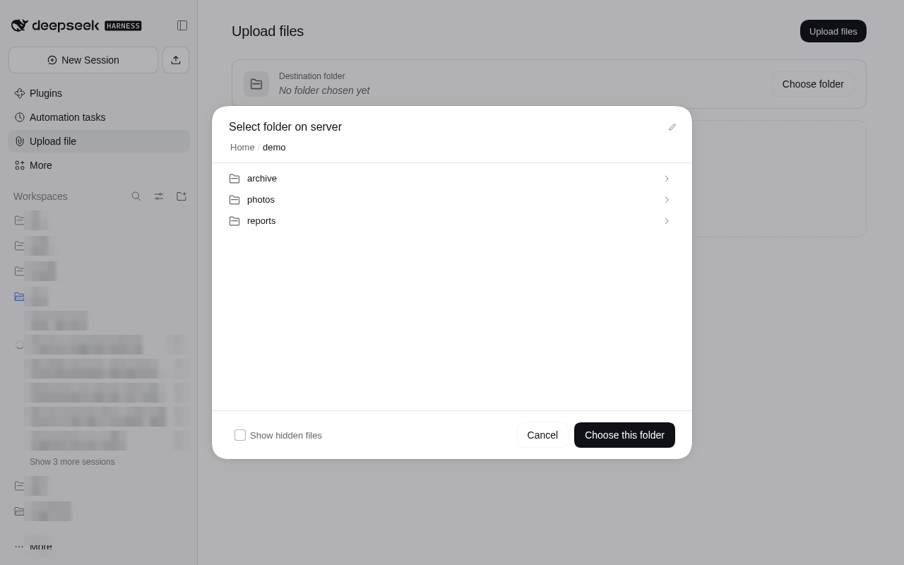

<div align="center">

[English](../../README.md) · [简体中文](README_zh.md) · [繁體中文](README_zh-TW.md) · [日本語](README_ja.md) · [한국어](README_ko.md) · [Türkçe](README_tr.md) · [Русский](README_ru.md) · [Tiếng Việt](README_vi.md) · [ไทย](README_th.md) · [Deutsch](README_de.md) · [Español](README_es.md) · [Français](README_fr.md) · [Українська](README_uk.md) · **Polski** · [Português (Brasil)](README_pt-BR.md) · [العربية](README_ar.md) · [فارسی](README_fa.md) · [Bahasa Indonesia](README_id.md) · [Italiano](README_it.md)
· [Ελληνικά](README_el.md) · [മലയാളം](README_ml.md) · [Roman Urdu](README_ur-Latn.md) · [Română](README_ro.md) · [Български](README_bg.md)

# @dsh-plugins/file-upload

**Wiersz ze spinaczem pod sekcją Zadania automatyzacji** w pasku bocznym interfejsu webowego [DSH](https://github.com/deepseek-ai/deepseek-harness), który otwiera stronę przesyłania: wybierz folder na Hoście w taki sam sposób, jak robi to okno dialogowe przestrzeni roboczej, zaznacz kilka plików naraz i patrz, jak każdy z nich przesyła się z własnym paskiem postępu.


<sub>Nazwy przestrzeni roboczych i sesji w pasku bocznym są rozmyte.</sub>

</div>

## Dlaczego

DSH potrafi wyprowadzać bajty *z* przestrzeni roboczej ([`@dsh-plugins/file-download`](https://github.com/tribesman/dsh-file-download)) i przygotowuje załączniki z przeglądarki dla jednego polecenia, ale nie było sposobu, by umieścić kilka istniejących plików w folderze na serwerze bez powłoki na Hoście. Ta wtyczka dodaje brakujący element, w miejscu, w którym mieszkają pozostałe panele globalne.

## Gdzie się pojawia

| Miejsce | Co |
| --- | --- |
| Lewy pasek boczny | Wiersz **Prześlij plik** z ikoną spinacza, bezpośrednio pod **Zadania automatyzacji** (`order: 11`) |
| Główna kolumna | Strona przesyłania, otwierana przez wybranie tego wiersza |


Wszystko na stronie to jeden przepływ:

1. **Folder docelowy** — *Wybierz folder* otwiera okno dialogowe w aplikacji, oparte na własnym wykazie katalogów Hosta (`ctx.uiWorkspace.listDirectory`, ten sam prymityw, który stoi za **Wybierz katalog przestrzeni roboczej**): przeskoki po okruszkach, ścieżka edytowana kliknięciem, przełącznik ukrytych folderów i potwierdzenie *Wybierz ten folder*. Lista folderów pochodzi z Hosta, więc działa ze zdalnej przeglądarki, w której nie ma systemowego okna wyboru.

   

2. **Wybierz pliki** — selektor plików na stronie przyjmuje kilka plików naraz, a pliki upuszczone w dowolnym miejscu strony dołączają do tej samej kolejki.
3. **Prześlij pliki** — kolejka przetwarza po jednym pliku; każdy wiersz pokazuje licznik wysłanych bajtów, pasek postępu i etykietę stanu. Nieudany wiersz zachowuje swój komunikat i oferuje **Ponów**; **Anuluj przesyłanie** zatrzymuje kolejkę i pozostawia pozostałe wiersze gotowe.

   

## Jak to działa

**Część hostowa** — jedna uwierzytelniona trasa strumieniowa na wspólnej granicy `/api`:

```
POST /api/file-upload/write?dir=<absolute folder>&name=<file name>
content-type: application/octet-stream
```

Trasa opiera się na `ctx.connection.fetch`, więc Connection dopuszcza żądanie wobec podpisanego poświadczenia Harnessa przeglądarki, zanim uruchomi się ten handler: nieuwierzytelnione żądanie nigdy do niego nie dociera i obsługiwany jest wyłącznie Peer właściciela. Obie współrzędne są walidowane (bezwzględny, istniejący katalog; jedna nazwa pliku bez żadnego separatora), a treść jest strumieniowana wprost do sąsiedniego pliku `.dsh-upload-<uuid>.part`, który trafia na swoje miejsce dopiero po ostatnim bajcie — przerwane lub nieudane przesyłanie nie zostawia niczego pod prawdziwą nazwą.

**Część przeglądarkowa** — napisany ręcznie bundle lazy-CJS, który wymaga wyłącznie bazy wstępnie dostarczonej przez powłokę (`react`, `react-dom`). Rejestruje dwa wkłady: wiersz `sidebar.panellist` i panel `main` o tym samym kluczu, i to jest cały kontrakt, jakiego pasek boczny potrzebuje, by go wybrać. O tym, że postęp każdego pliku jest prawdziwy, decyduje zwykły `XMLHttpRequest` w wątku strony: `xhr.upload.onprogress` raportuje bajty, które przeglądarka faktycznie przekazała gniazdu.

## Instalacja

Pakiet jest **bundle** (`dsh.bundle.patch`), więc Menedżer wtyczek może go zainstalować i aktualizować jako jeden wiersz:

```bash
# z kopii roboczej — podłącza ten katalog, zmiany działają na żywo
dsh plugin --profile web add /path/to/dsh-file-upload

# albo ze zdalnego repozytorium git
dsh plugin --profile web add "git+https://github.com/tribesman/dsh-file-upload.git"
```

Obie drogi można też wybrać w interfejsie: **Wtyczki → Dodaj wtyczkę**.

Bez `dsh` na `PATH` podlinkuj kopię roboczą do profilu i dodaj wiersz ręcznie:

```yaml
# $DSH_HOME/profiles/web/cordis.patch.yml
- insert:
    - id: file-upload-panel
      name: '@dsh-plugins/file-upload'
```

```bash
ln -s /path/to/dsh-file-upload \
  "$DSH_HOME/profiles/web/node_modules/@dsh-plugins/file-upload"
```

Identyfikator wiersza nie może powtarzać identyfikatora żadnego z dostarczanych: `file-upload` należy już do `@deepseek-ai/dsh-client-file-upload`, transportu załączników do poleceń po stronie przeglądarki, a dwa wpisy Loadera dzielące jeden identyfikator składają tylko jeden z nich. Stąd `file-upload-panel`.

Uruchom harness ponownie raz, aby nowo dodany wiersz Loadera się złożył. W działającej instancji wstawiony wiersz montuje się bez restartu.

Sprawdź, że działa: w pasku bocznym pojawia się **Prześlij plik** tuż pod **Zadania automatyzacji**, strona wyświetla folder domowy Hosta, a zakończone przesyłanie ląduje w wybranym folderze:

```bash
ls -l "/the/folder/you/chose"
```

## Konfiguracja

Oba parametry mieszkają w `config` wiersza wtyczki, więc warstwa patcha profilu zachowuje je podczas aktualizacji:

```yaml
- id: file-upload-panel
  name: '@dsh-plugins/file-upload'
  config:
    maxFileBytes: 1048576      # domyślnie 1073741824 (1 GiB), 1024 … 16 GiB
    conflict: overwrite        # domyślnie "rename"
```

| Pole | Domyślnie | Znaczenie |
| --- | --- | --- |
| `maxFileBytes` | `1073741824` | Górny limit rozmiaru jednego pliku; sama wartość graniczna jest dozwolona, a większa treść jest odrzucana z `413` i nic nie zostaje zapisane |
| `conflict` | `"rename"` | Co oznacza zajęta nazwa: `rename` zachowuje istniejący plik, a nowy umieszcza jako `name (1).ext`; `overwrite` zastępuje go |

Schemat wiersza to ręcznie napisana Standard Schema, więc powyższe wartości są walidowane przy aktywacji wtyczki, a błędna wartość kończy się błędem wiersza. Menedżer wtyczek czyta wyłącznie natywne grafy Schemastery, dlatego jego formularz konfiguracji zgłasza schemat tego wiersza jako nieobsługiwany i nie pokazuje żadnych pól: ustaw wartości w patchu, jak pokazano wyżej.

## Uwagi o bezpieczeństwie

- Trasa jest **dokładną trasą na granicy `/api` usługi Connection**, a nie surową ścieżką serwera webowego, więc wymaga podpisanego ciasteczka sesji przeglądarki i obsługuje wyłącznie Peera właściciela. Nie wprowadza też własnego poluzowania zasad Host/Origin.
- Trasa zapisuje tam, gdzie wskaże uwierzytelniony operator, z uprawnieniami procesu DSH — ten sam zasięg, jaki mają selektor katalogu przestrzeni roboczej i narzędzie `bash`. Folder docelowy musi już istnieć; wtyczka nie tworzy folderów.
- Przeglądarka podaje folder i nazwę pliku, nigdy ścieżkę wewnątrz niego: nazwa nie zawiera kropek ani separatorów, więc żądanie nie może wydostać się z wybranego folderu.
- Pliki tymczasowe powstają obok celu i są usuwane przy błędzie lub anulowaniu; pod nazwą docelową nic nie zostaje, dopóki nie dotrą wszystkie bajty.

## Znane ograniczenia

- Jedna kolejka przesyłania na jedno odwiedzenie strony: lista jest lokalna dla strony, a opuszczenie strony w trakcie przesyłania nie przerywa transferu (Host kończy plik), ale gubi wiersze.
- Brak tworzenia folderów w selektorze i brak wznawiania: nieudane przesyłanie zaczyna od nowa od pierwszego bajtu.
- Selektor listuje wyłącznie foldery, a obcięte poziomy zgłaszają `truncated` zamiast stronicowania.
- Strona nie ma po stronie klienta wstępnej weryfikacji `maxFileBytes`: zbyt duży plik jest odrzucany przez Hosta po zakończeniu transferu.
- Host pisze tekst błędu po angielsku i zachowuje kod errno w komunikacie.

## Rozwój

```bash
npm test        # node --test: 22 przypadki obejmujące trasę i bundle
npm run check   # kontrola składni obu części
```

Testy Hosta przepuszczają trasę przez prawdziwe obiekty `Request`/`Response` i prawdziwy katalog tymczasowy, więc obejmują ścieżkę bajtów, zasady rozwiązywania konfliktów, górny limit rozmiaru, anulowanie i tekst błędu — bez harnessa. Testy przeglądarki wykonują bundle w maszynie wirtualnej z zaślepkami React i DOM, więc nie potrzebują ani harnessa, ani przeglądarki.

## Pliki

| Ścieżka | Rola |
| --- | --- |
| `lib/index.js` | Część hostowa: trasa strumieniowego zapisu i jej schemat konfiguracji |
| `lib/client.js` | Część przeglądarkowa: bundle lazy-CJS, wiersz paska bocznego, strona, okno folderów |
| `cordis.patch.yml` | Patch bundle'a: jedyny wiersz Hosta |
| `locale/*.json` | Tytuł i opis wyświetlane w Menedżerze wtyczek |
| `icon.svg` | Ikona kafelka ze spinaczem |
| `docs/assets/*.png` | Zrzuty ekranu używane przez ten README i jego tłumaczenia |
| `docs/readme/README_*.md` | Przetłumaczone README |
| `test/host.test.mjs` | Zachowanie trasy: statusy, zasady, limit, anulowanie, tekst błędu |
| `test/client.test.mjs` | Kontrakt bundle: kształt wiersza, kolejność, słowniki, arkusz stylów |

## Tłumaczenia

[English](../../README.md) · [简体中文](README_zh.md) · [繁體中文](README_zh-TW.md) · [日本語](README_ja.md) · [한국어](README_ko.md) · [Türkçe](README_tr.md) · [Русский](README_ru.md) · [Tiếng Việt](README_vi.md) · [ไทย](README_th.md) · [Deutsch](README_de.md) · [Español](README_es.md) · [Français](README_fr.md) · [Українська](README_uk.md) · **[Polski](README_pl.md)** · [Português (Brasil)](README_pt-BR.md) · [العربية](README_ar.md) · [فارسی](README_fa.md) · [Bahasa Indonesia](README_id.md) · [Italiano](README_it.md) · [Ελληνικά](README_el.md) · [മലയാളം](README_ml.md) · [Roman Urdu](README_ur-Latn.md) · [Română](README_ro.md) · [Български](README_bg.md)

Przetłumaczone README znajdują się w [`docs/readme/`](.). Opisują tę samą wtyczkę; tam, gdzie nie zgadzają się z tym plikiem, wygrywa ten plik.

## Licencja

MIT.
