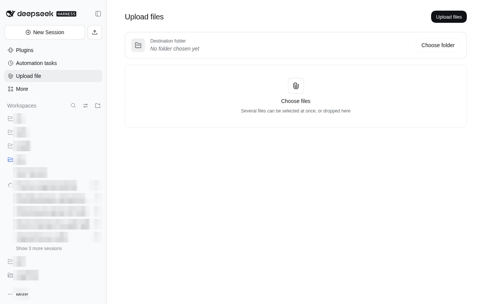

<div align="center">

[English](../../README.md) · [简体中文](README_zh.md) · [繁體中文](README_zh-TW.md) · [日本語](README_ja.md) · [한국어](README_ko.md) · [Türkçe](README_tr.md) · [Русский](README_ru.md) · [Tiếng Việt](README_vi.md) · [ไทย](README_th.md) · [Deutsch](README_de.md) · [Español](README_es.md) · [Français](README_fr.md) · [Українська](README_uk.md) · [Polski](README_pl.md) · **Português (Brasil)** · [العربية](README_ar.md) · [فارسی](README_fa.md) · [Bahasa Indonesia](README_id.md) · [Italiano](README_it.md)
· [Ελληνικά](README_el.md) · [മലയാളം](README_ml.md) · [Roman Urdu](README_ur-Latn.md) · [Română](README_ro.md) · [Български](README_bg.md)

# @dsh-plugins/file-upload

**Uma linha com clipe de papel sob a seção Tarefas de automação** na barra lateral web do [DSH](https://github.com/deepseek-ai/deepseek-harness) que abre uma página de envio: escolha uma pasta no host do mesmo jeito que a janela do espaço de trabalho faz, marque vários arquivos de uma vez e acompanhe cada um sendo enviado com sua própria barra de progresso.


<sub>Os nomes de espaços de trabalho e de sessões na barra lateral estão desfocados.</sub>

</div>

## Por que

O DSH consegue mover bytes *para fora* do espaço de trabalho ([`@dsh-plugins/file-download`](https://github.com/tribesman/dsh-file-download)) e prepara anexos do navegador para um prompt, mas não havia jeito de colocar vários arquivos existentes em uma pasta no servidor sem um shell no host. Este plugin fornece a peça que faltava, no lugar onde ficam os outros painéis globais.

## Onde aparece

| Lugar | O quê |
| --- | --- |
| Barra lateral esquerda | Uma linha **Enviar arquivo** com o ícone de clipe de papel, logo abaixo de **Tarefas de automação** (`order: 11`) |
| Coluna principal | A página de envio, aberta ao selecionar essa linha |



Tudo na página é um único fluxo:

1. **Pasta de destino** — *Escolher pasta* abre uma janela dentro do app, alimentada pela listagem de diretórios do próprio host (`ctx.uiWorkspace.listDirectory`, a mesma primitiva por trás de **Selecionar diretório do espaço de trabalho**): saltos pelos breadcrumbs, um caminho editável com clique, alternância de pastas ocultas e a confirmação *Escolher esta pasta*. A lista de pastas vem do host, então funciona a partir de um navegador remoto, onde não existe seletor do sistema operacional.

   

2. **Escolher arquivos** — o seletor de arquivos da página aceita vários arquivos de uma vez, e arquivos soltos em qualquer ponto da página entram na mesma fila.
3. **Enviar arquivos** — a fila processa um arquivo por vez; cada linha mostra o contador de bytes enviados, uma barra de progresso e uma etiqueta de estado. Uma linha que falha mantém a mensagem e oferece **Tentar novamente**; **Cancelar envio** para a fila e deixa as linhas restantes prontas.

   

## Como funciona

**Lado do host** — uma rota de streaming autenticada na barreira compartilhada `/api`:

```
POST /api/file-upload/write?dir=<absolute folder>&name=<file name>
content-type: application/octet-stream
```

Ela fica em `ctx.connection.fetch`, então o Connection admite a requisição contra a credencial assinada do Harness no navegador antes que este handler rode: uma requisição não autenticada nunca chega até ele, e só o Peer proprietário é atendido. As duas coordenadas são validadas (um diretório absoluto e existente; um nome de arquivo puro, sem separador), e o corpo vai em streaming direto para um arquivo irmão `.dsh-upload-<uuid>.part`, que só é renomeado para o lugar definitivo depois que o último byte chega — um envio abortado ou que falha não deixa nada sob o nome real.

**Lado do navegador** — um bundle lazy-CJS escrito à mão que exige apenas a base pré-carregada pelo shell (`react`, `react-dom`). Ele registra duas contribuições: a linha `sidebar.panellist` e o painel `main` com a mesma chave, e esse é todo o contrato de que a barra lateral precisa para selecioná-lo. O `XMLHttpRequest` comum na thread da página é o que torna real o progresso por arquivo: `xhr.upload.onprogress` informa os bytes que o navegador de fato entregou ao socket.

## Instalação

O pacote é um **bundle** (`dsh.bundle.patch`), então o Gerenciador de plugins pode instalá-lo e atualizá-lo como uma única linha:

```bash
# a partir de um checkout — cria um link para este diretório, as edições ficam ao vivo
dsh plugin --profile web add /path/to/dsh-file-upload

# ou a partir do remoto git
dsh plugin --profile web add "git+https://github.com/tribesman/dsh-file-upload.git"
```

Os dois caminhos também podem ser usados pela interface: **Plugins → Adicionar plugin**.

Sem o `dsh` no `PATH`, crie um link simbólico do checkout dentro do perfil e adicione a linha à mão:

```yaml
# $DSH_HOME/profiles/web/cordis.patch.yml
- insert:
    - id: file-upload-panel
      name: '@dsh-plugins/file-upload'
```

```bash
ln -s /path/to/dsh-file-upload \
  "$DSH_HOME/profiles/web/node_modules/@dsh-plugins/file-upload"
```

O id da linha não pode repetir um id já fornecido: `file-upload` já pertence a `@deepseek-ai/dsh-client-file-upload`, o transporte de anexos de prompt do navegador, e duas entradas de Loader que compartilham um id compõem apenas uma delas. Daí `file-upload-panel`.

Reinicie o harness uma vez para que uma linha de Loader recém-adicionada seja composta. Em uma instância em execução, uma linha inserida é montada sem reinício.

Confira se funciona: a barra lateral ganha **Enviar arquivo** logo abaixo de **Tarefas de automação**, a página lista a pasta pessoal do host, e um envio concluído cai na pasta que você escolheu:

```bash
ls -l "/the/folder/you/chose"
```

## Configuração

Os dois ajustes ficam no `config` da linha do plugin, então a camada de patch do perfil os mantém entre atualizações:

```yaml
- id: file-upload-panel
  name: '@dsh-plugins/file-upload'
  config:
    maxFileBytes: 1048576      # padrão 1073741824 (1 GiB), 1024 … 16 GiB
    conflict: overwrite        # padrão "rename"
```

| Campo | Padrão | Significado |
| --- | --- | --- |
| `maxFileBytes` | `1073741824` | Teto inclusivo para um arquivo; um corpo maior é recusado com `413` e nada é gravado |
| `conflict` | `"rename"` | O que um nome ocupado significa: `rename` mantém o arquivo existente e coloca o novo como `name (1).ext`; `overwrite` o substitui |

A linha declara seu schema como um Standard Schema escrito à mão, então os valores acima são validados quando o plugin ativa, e um valor ruim faz a linha falhar com um erro. O Gerenciador de plugins lê apenas grafos nativos do Schemastery, por isso seu formulário de configuração informa o schema desta linha como não suportado e não oferece campos: defina os valores no patch, como mostrado acima.

## Notas de segurança

- A rota é uma **rota exata na barreira `/api` do Connection**, não um caminho cru de servidor web, então exige o cookie de sessão assinado do navegador e atende apenas o Peer proprietário. Ela também não adiciona nenhum relaxamento próprio de Host/Origin.
- A rota grava onde o operador autenticado apontar, com as permissões do processo do DSH — o mesmo alcance que o seletor de diretório do espaço de trabalho e a ferramenta `bash` já têm. A pasta de destino precisa já existir; o plugin não cria pastas.
- O navegador informa uma pasta e um nome de arquivo, nunca um caminho dentro dela: o nome não tem `.` nem separadores, então uma requisição não consegue escapar da pasta escolhida.
- Arquivos temporários são criados ao lado do destino e removidos em caso de falha ou cancelamento; nada fica sob o nome final a menos que todos os bytes tenham chegado.

## Limitações conhecidas

- Uma fila de envio por visita à página: a lista é local à página, e sair da página no meio do envio mantém a transferência rodando (o host termina o arquivo), mas esquece as linhas.
- Não há criação de pastas no seletor nem retomada: um envio que falha recomeça do primeiro byte.
- O seletor lista apenas pastas, e níveis cortados informam `truncated` em vez de paginação.
- A página não tem verificação prévia de `maxFileBytes` no cliente: um arquivo grande demais é recusado pelo host depois da transferência.
- O host escreve o texto de erro em inglês e mantém o código errno na mensagem.

## Desenvolvimento

```bash
npm test        # node --test: 22 casos sobre a rota e o bundle
npm run check   # verificação de sintaxe nas duas partes
```

Os testes do host conduzem a rota por objetos `Request`/`Response` reais e um diretório temporário real, então cobrem o caminho dos bytes, as políticas de conflito, o teto de tamanho, o cancelamento e o texto de falha sem um harness. Os testes do navegador executam o bundle em uma VM com um stub de React e de DOM, então não precisam nem de harness nem de navegador.

## Arquivos

| Caminho | Papel |
| --- | --- |
| `lib/index.js` | Lado do host: a rota de escrita em streaming e seu schema de configuração |
| `lib/client.js` | Lado do navegador: bundle lazy-CJS, linha da barra lateral, página, janela de pastas |
| `cordis.patch.yml` | Patch do bundle: a única linha de host |
| `locale/*.json` | Título e descrição exibidos no Gerenciador de plugins |
| `icon.svg` | O ícone do bloco com clipe de papel |
| `docs/assets/*.png` | Capturas de tela usadas por este README e suas traduções |
| `docs/readme/README_*.md` | Os READMEs traduzidos |
| `test/host.test.mjs` | Comportamento da rota: status, políticas, teto, cancelamento, texto de falha |
| `test/client.test.mjs` | Contrato do bundle: formato da linha, ordem, dicionários, folha de estilo |

## Traduções

[English](../../README.md) · [简体中文](README_zh.md) · [繁體中文](README_zh-TW.md) · [日本語](README_ja.md) · [한국어](README_ko.md) · [Türkçe](README_tr.md) · [Русский](README_ru.md) · [Tiếng Việt](README_vi.md) · [ไทย](README_th.md) · [Deutsch](README_de.md) · [Español](README_es.md) · [Français](README_fr.md) · [Українська](README_uk.md) · [Polski](README_pl.md) · **[Português (Brasil)](README_pt-BR.md)** · [العربية](README_ar.md) · [فارسی](README_fa.md) · [Bahasa Indonesia](README_id.md) · [Italiano](README_it.md) · [Ελληνικά](README_el.md) · [മലയാളം](README_ml.md) · [Roman Urdu](README_ur-Latn.md) · [Română](README_ro.md) · [Български](README_bg.md)

Os READMEs traduzidos ficam em [`docs/readme/`](.). Eles descrevem o mesmo plugin; onde divergirem deste arquivo, este arquivo vence.

## Licença

MIT.
